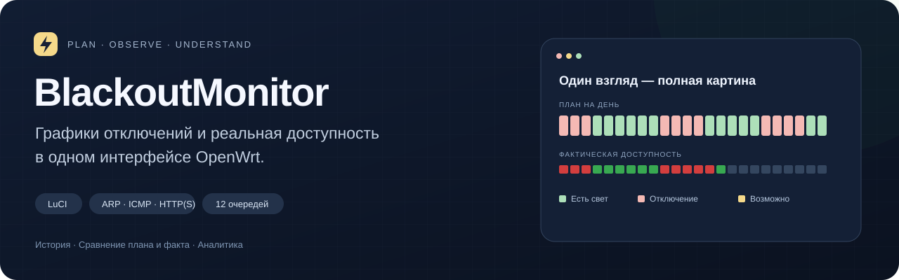
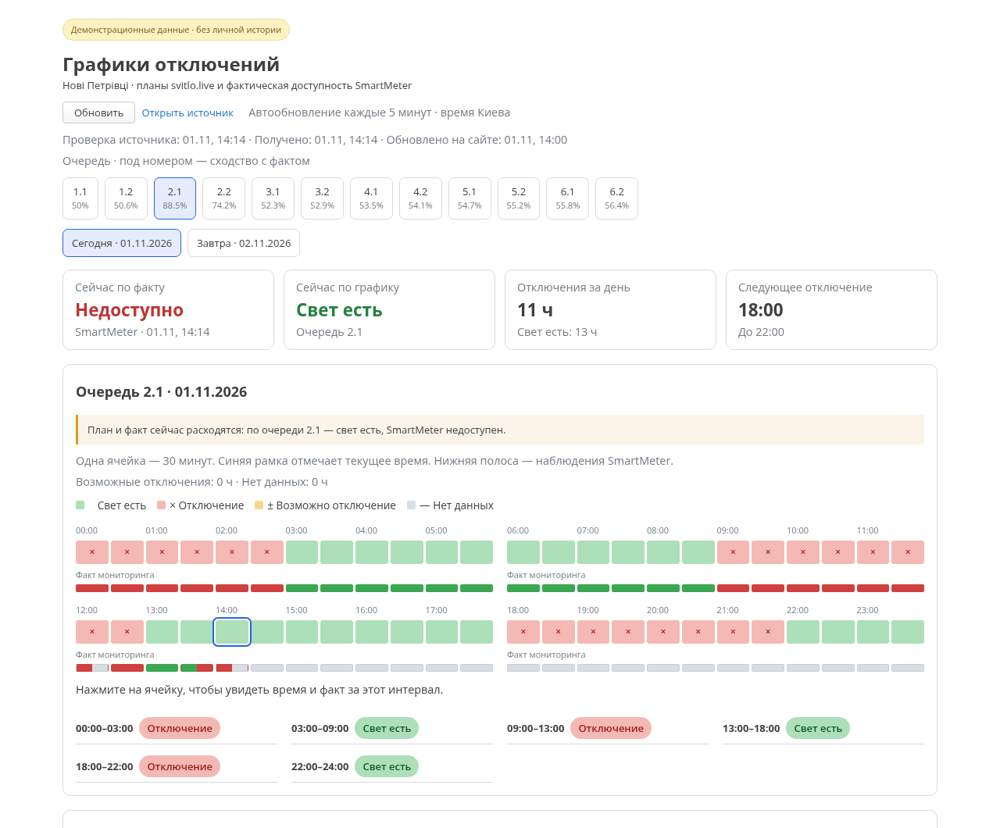
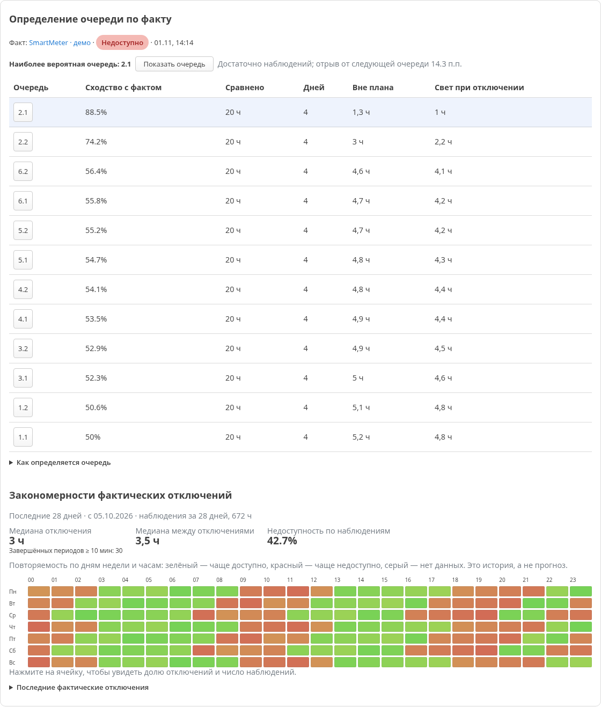
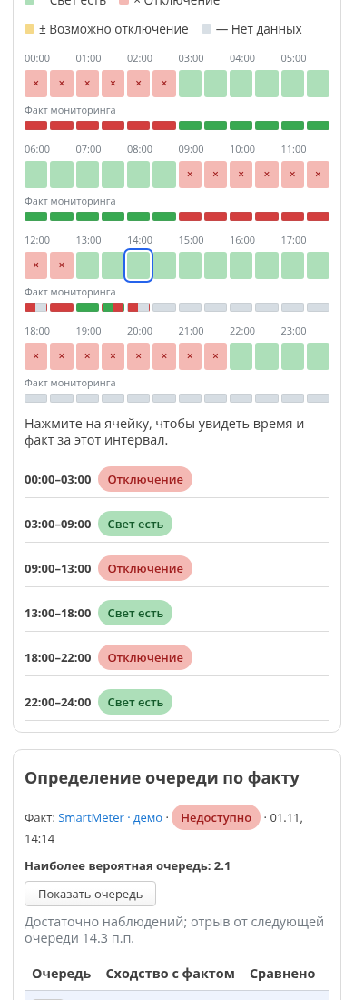

<div align="center">



**Графики отключений и фактическая доступность — в одном интерфейсе OpenWrt.**


[Возможности](#возможности) · [Установка](docs/INSTALL.md) · [Как работает аналитика](docs/ANALYTICS.md) · [Скриншоты](#интерфейс)

</div>

## Один проект, два раздела LuCI

BlackoutMonitor объединяет **мониторинг устройств и сайтов** с **графиками отключений электричества**. План поставщика отображается рядом с реальными наблюдениями SmartMeter: расхождения видны сразу, а история помогает определить наиболее подходящую очередь и увидеть повторяющиеся отключения.

| Раздел | Что показывает |
| --- | --- |
| **Services → Мониторинг доступности** | Независимые ARP, ICMP и HTTP(S) проверки, состояние сейчас, календарь, детализацию и периоды доступности/сбоев. |
| **Services → Графики отключений** | План на сегодня и завтра, факт SmartMeter, рейтинг очередей, повторяемость по дням и часам, сходство графиков. |

В состав проекта входит код [SmartMeterMonitor](https://github.com/garik816/SmartMeterMonitor). **BlackoutMonitor — основной репозиторий для совместного развития обоих разделов.** Предыдущий репозиторий и его история сохранены.

## Интерфейс



*Снимки сделаны из рабочего интерфейса с демонстрационными данными. Реальные адреса, конфигурация и история пользователя в репозиторий не включены.*

<details>
<summary><strong>Определение очереди и закономерности</strong></summary>



</details>

<details>
<summary><strong>Интерфейс на телефоне</strong></summary>



</details>

## Возможности

### Наблюдать за реальной доступностью

- **ARP** — проверка локального устройства, при необходимости с контролем MAC.
- **ICMP** — проверка IP-адреса или имени через ping.
- **HTTP/HTTPS** — GET с переходами, проверкой TLS и ожидаемого HTTP-кода.
- До **30 независимых проверок**, с отдельными интервалом, тайм-аутом и историей.
- Дневная и поминутная детализация, периоды доступности и отключений.

### Сравнивать график с фактом

- Все **12 очередей** для **Нові Петрівці** из [svitlo.live](https://svitlo.live/selo-novi-petrivtsi).
- Сегодня и завтра, ячейки по **30 минут**, понятные интервалы и текущее время Киева.
- Отдельная полоса реальных наблюдений под планом и заметное сообщение о расхождении.
- Запоминание выбранной очереди и поддержка узких экранов.
- Фоновый сбор графиков каждые **5 минут**, даже при закрытом LuCI.
- Последний корректный график остаётся доступным при ошибке источника с явной отметкой об ошибке.

### Находить закономерности

- Рейтинг очередей по совпадению с фактом SmartMeter.
- Раздельный учёт отключений вне плана и наличия света во время планового отключения.
- Карта повторяемости по дням недели и часам за **28 дней**.
- Медианная продолжительность отключений и промежутков между ними.
- Сравнение очередей: совпадение состояний, пересечение отключений, корреляция и сдвиги до ±6 часов.

> **План и факт не смешиваются.** В этой конфигурации недоступность основного SmartMeter принята за факт отключения. Ошибки проверки, пробелы и неизвестные периоды не превращаются в отключения. Статистические закономерности описывают наблюдения и не гарантируют время следующего переключения.

## Начать работу

Проект проверен на **OpenWrt 25.12.6 x86/64 с LuCI**. Он устанавливается копированием исходных файлов; готовый `.ipk`/`.apk` пакет пока не поставляется.

1. Установите зависимости и скопируйте `files/` на роутер.
2. Для новой установки задайте адрес устройства в проверке `main`.
3. Включите обе службы и откройте разделы LuCI.

**[Пошаговая установка и обновление →](docs/INSTALL.md)**

При обновлении с SmartMeterMonitor сохраняются существующие настройки и базы. Файл конфигурации в поставке — только `.example`; рабочая конфигурация автоматически не заменяется.

## Как определяется очередь

Для сравнения используется последняя редакция графика, сохранённая **до соответствующего наблюдения**. Новая редакция не улучшает прошлый результат задним числом.

Сходство — среднее точности во время фактических отключений и во время доступности. Поэтому очередь с постоянным «нет света» не получает преимущества только из-за долгого отключения.

Устойчивый кандидат показывается при выполнении всех условий:

| Условие | Минимум |
| --- | --- |
| Дни со сравнёнными наблюдениями | 3 дня |
| Объём сравнений | 6 часов |
| Наблюдения каждого фактического состояния | 1 час доступности и 1 час отключений |
| Сходство | 70% |
| Отрыв от следующей очереди | 10 процентных пунктов |

Похожие очереди остаются предварительными, одинаковые результаты показываются вместе. Архив опубликованных графиков начинается с момента включения функции; старая история SmartMeter уже полезна для карты закономерностей, но не заменяет отсутствующие старые графики.

**[Методика, ограничения и хранение данных →](docs/ANALYTICS.md)**

## Проверка исходников

```sh
python3 tests/test_availability.py
python3 tests/test_svitlo.py
```

Тесты проверяют границы периодов доступности, перезапуски и пробелы наблюдений, получасовые переходы, редакции графиков, рейтинг и неоднозначность очередей, архивирование и восстановление после ошибок HTTP. Тестовые базы создаются во временном каталоге.

## Структура проекта

```text
files/
├── etc/init.d/                         # Службы procd
├── etc/config/                        # Пример конфигурации мониторинга
├── usr/bin/                           # Сборщик фактической доступности
├── usr/libexec/                       # API страницы, адаптер и аналитика
├── usr/share/luci/menu.d/              # Два пункта меню
├── usr/share/rpcd/acl.d/               # Права доступа LuCI
├── usr/share/ucode/luci/template/      # Версионирование ресурсов
└── www/luci-static/resources/view/     # Интерфейс обеих страниц

docs/                                  # Установка, методика и изображения
tests/                                 # Проверки без рабочих баз пользователя
```

Текущий адаптер графиков привязан к **Нові Петрівці**. Для другого населённого пункта потребуется адаптация источника; переключателя города в интерфейсе пока нет.
