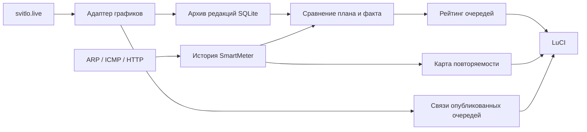

# План, факт и аналитика

[← К проекту](../README.md)

## Откуда берутся данные



Источник планов — [страница Нові Петрівці на svitlo.live](https://svitlo.live/selo-novi-petrivtsi). Адаптер читает все 12 очередей на две опубликованные даты. Одна ячейка источника может содержать два разных состояния по половине часа; они сохраняются раздельно.

Известны четыре состояния: наличие света, отключение, возможное отключение и отсутствие информации. Неизвестная структура страницы или обозначение считаются ошибкой разбора, а не наличием света.

Кеш действует 5 минут; ручные повторные запросы ограничены минутой. Фоновая служба работает без открытой страницы LuCI. При временной ошибке последняя корректная версия остаётся в кеше с сообщением об ошибке.

## Что считается фактом

Источник факта — проверка с идентификатором `main` из существующей конфигурации мониторинга. Типичный вариант — локальное устройство SmartMeter, проверяемое через ARP.

За каждую минуту берётся большинство наблюдений `up` или `down`. Равенство, отсутствие наблюдений и ошибки исключаются. В конфигурации проекта недоступность выбранного устройства принимается за факт отключения электричества; сама проверка измеряет доступность устройства.

Паузы и перезапуски мониторинга не заполняются выдуманными состояниями. Если измерение устарело, интерфейс не показывает его как текущее.

## Рейтинг очередей

Для каждой наблюдавшейся минуты выбирается последняя редакция графика, полученная **не позднее начала этой минуты**. Если график появился позже, эта минута не влияет на рейтинг. Более поздние исправления источника не меняют оценку старых предсказаний задним числом.

В сравнение входят только определённые состояния `on` и `off`; возможные отключения и отсутствие информации пропускаются.

Сходство рассчитывается как balanced accuracy:

```text
Точность при доступности = верно предсказанные on / фактические on
Точность при отключении  = верно предсказанные off / фактические off

Сходство = 100% × (точность при доступности + точность при отключении) / 2
```

Это не вероятность принадлежности к официальной очереди. Метрика уравнивает вклад обоих состояний: постоянный прогноз «отключено» не выигрывает только из-за длительного фактического отключения.

Если наблюдалось лишь одно фактическое состояние, сходство не рассчитывается. Устойчивый кандидат требует одновременно:

- не меньше 3 дней сравнений;
- не меньше 360 сравнённых минут;
- не меньше 60 минут каждого фактического состояния;
- сходство не меньше 70%;
- отрыв от следующего результата не меньше 10 процентных пунктов.

Одинаково подходящие очереди показываются вместе. Остальные результаты помечаются как предварительные.

«Вне плана» — фактическая недоступность при определённом прогнозе `on`. «Свет при отключении» — фактическая доступность при определённом прогнозе `off`.

## Повторяемость отключений

Анализируется последнее 28-дневное окно. Карта «день недели × час» показывает долю недоступных минут среди наблюдавшихся минут. У каждой ячейки есть число минут и дней, на которых основан результат; его можно увидеть нажатием.

Красный означает более частую недоступность, зелёный — доступность, серый — отсутствие наблюдений. Это описание истории, а не прогноз следующего отключения.

Медиана отключения считается по завершённым, непрерванным периодам длиной от 10 минут. Для промежутков между отключениями не объединяются разные запуски мониторинга.

## Связи между очередями

Сравниваются текущие опубликованные планы на обе даты, только в определённых получасовых ячейках.

| Метрика | Значение |
| --- | --- |
| Совпадение состояний | Доля ячеек, где обе очереди имеют одинаковое состояние |
| Пересечение отключений | Общие `off` / ячейки, где хотя бы одна очередь `off` |
| Корреляция | Pearson correlation бинарного признака отключения: от −1 до +1 |
| Сдвиг | Наиболее похожий рисунок в пределах ±6 часов |

Положительный сдвиг означает, что похожие периоды другой очереди идут позже выбранной. Ячейки не переносятся через полночь; для оценки сдвига нужны минимум 16 определённых пар ячеек. На коротком участке высокая корреляция может быть случайной. Эти метрики показывают сходство планов и не доказывают причинной зависимости очередей.

## Хранение

Каждая изменившаяся редакция сохраняется в `/root/svitlo-schedule.sqlite3` с фактическим временем получения. Повтор одного и того же состояния не создаёт новую запись; последовательность A → B → A сохраняет три редакции. Архив хранится 90 дней.

Рабочие базы, конфигурация и HTTP-кеш не входят в репозиторий. Иллюстрации документации используют только демонстрационные данные.
